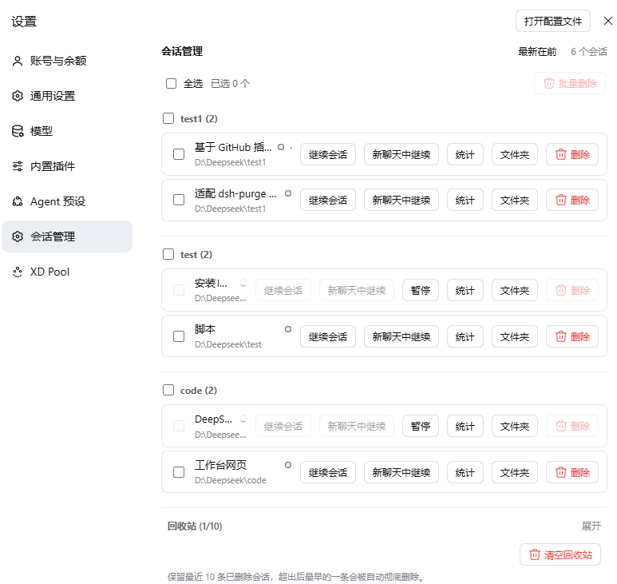
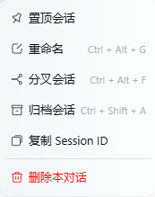
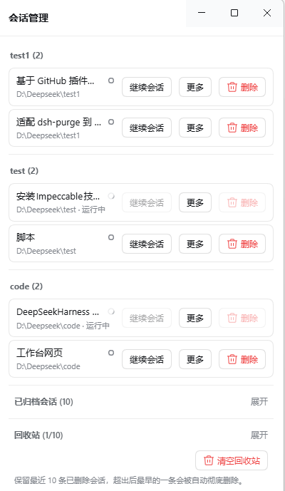
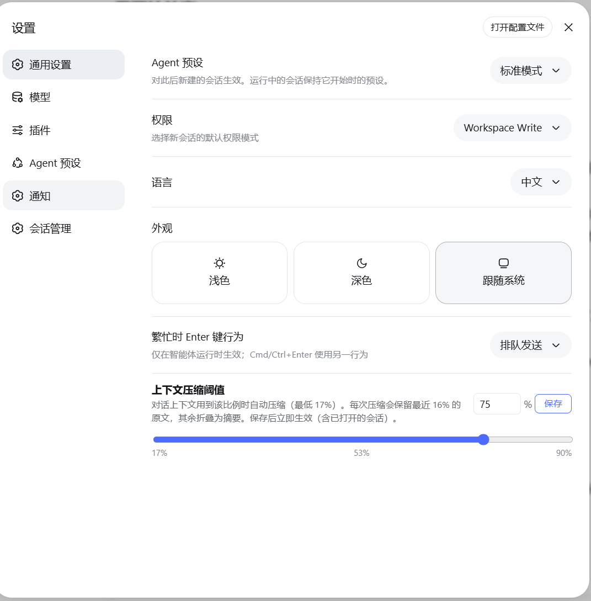

# dsh-session-manager

English | [中文](README.md)

Full **session management** inside the DeepSeek Harness web UI — reachable from both the Settings page and
the conversation header: delete (with a recoverable trash that can also be emptied in one click), restore
archived sessions, activity stats, continue/pause, open the log folder, unread markers, fork into a new
chat, workspace grouping and ordering, and a global context-compaction threshold. No harness changes.

This repository is a derivative of [dream12347/dsh-session-manager](https://github.com/dream12347/dsh-session-manager)
(MIT), built on its v0.2.3 artifacts and published as **v0.4.1** with: DSH-native confirmation dialogs,
wider session-ID compatibility, **force delete**, and **empty trash**; it also fixes a startup crash caused
by duplicate route registration on plugin re-mount.

## What v0.4.1 changes

| # | Change | Detail |
|---|---|---|
| 1 | **Native dialogs** | Every `window.confirm()` / `window.alert()` is now the official `Modal` from `@deepseek-ai/dsh-client-ui-primitives`: body portal, mask blur, Escape handling, focus return, danger actions painted with `--dsw-alias-state-error-primary`, and the session id shown in a monospace block. No more OS message boxes from the desktop shell |
| 2 | **Wider session IDs** | Only `session-<hex>` used to pass validation, so ids minted by other surfaces (`od-<uuid>`) answered `invalid-session-id` and the session could not be deleted. Now any id that is safe as one path segment is accepted: `[A-Za-z0-9][A-Za-z0-9._-]{0,199}`, `..` rejected |
| 3 | **Force delete** | When a normal delete fails, the failure dialog offers Force delete: it skips the official archive step, falls back to locating the artifact at `~/.dsh/sessions/<project>/<id>`, and still moves it into the trash (restorable). `POST /dsh-session-manager/delete` accepts `{ sessionId, force: true }`; a session mid-turn is still refused |
| 4 | **Empty trash** | The trash gains an Empty trash button backed by `POST /dsh-session-manager/purge-all`: every entry and its on-disk folder is removed for good. Entries that cannot be removed stay recorded for a retry, and the response reports `purged` / `failed` / `remaining` |
| 5 | **Route-registration crash fix** | `webServer.register()` throws on a duplicate `(kind, path)`. A plugin re-mount (config reload, disable/enable, service replacement) re-registered the same nine routes while the previous generation was still in the table, and the exception escaped `apply()` — **failing host startup**. Routes now install through a process-wide table: a new mount takes its routes over (disposing the stale entry first), a remaining collision is logged, and a rejected `setup()` is contained so the plugin stays inactive instead of killing the host |

| 6 | **Delete moved into the row menu** | The red header button is gone; deleting a session is now a destructive row in the sidebar "..." menu (`sidebar.workspaces.session.menu.item`, order 500) beside pin / rename / fork / archive / copy-id, so the conversation title bar stays clean |

## Features

- A dedicated **Session Manager** section in Settings (a settings section, sibling to Notifications)
- Lists all sessions (title / working directory); **archived sessions** are grouped in a collapsible area at the bottom with a **one-click Restore** back to the list
- **Trash**: deleted sessions move to the trash (keeps the most recent 10, the oldest is purged automatically), with **Restore** and **Delete permanently** actions
- **Stats**: open a centered dialog with complete recent activity (turns / user messages / assistant messages / all tool calls / activity window)
- **Continue session**: open a session and close the panel; **Pause**: stop a running session's current turn
- **Unread / read**: a status dot next to each session's title — blue for manually marked unread, amber for the official waiting-for-input state, green for the official completion reminder, spinner while running; clicking an official dot marks it read **in place** (no navigation), clicking the blue dot clears the unread, opening a session auto-reads it; the official sidebar shows a matching blue unread dot on the session row
- **Fork into a new chat**: one click forks a child session (official `sessions.fork`) and opens it
- **Folder**: reveal the session's log directory in the system file manager
- **Delete this session**: a red button in the conversation header (left of Session log) to delete the current session
- **Session Manager / Trash** header buttons: a self-drawn right drawer (pin to keep open, outside-click to close); a "More" popover in each row holds Stats / Folder / Fork
- **Workspace management**: sessions are grouped by workspace, sorted by last use within each group (toggle newest/oldest first); drag a workspace title to reorder (insert before/after, swap on the title, drag to the bottom to append); hovering a title shows **Move to top / Rename / Delete** buttons (delete follows the official definition: it only removes the workspace from the list — the folder and session logs are kept, and its sessions appear under Ungrouped)
- **Context compaction threshold** (General settings): set at what fraction of the 1M-token model window the conversation context auto-compacts (17%–90%), keeping the most recent 16% verbatim; applies **globally to all agent presets** (immediate on save + persisted + auto-applied on restart)
- Delete restriction: only sessions **currently thinking** are protected; an open-but-idle session can be deleted
- Subagent sessions can be deleted when not running: even orphaned ones (whose parent session is already deleted) can be cleaned up directly from Session Manager
- UI language follows the active DSH app language and updates live (Chinese / English)

## Install

```sh
# From the release tarball (recommended)
dsh plugin --profile <profile> add https://github.com/JeffKeeping/dsh-session-manager/releases/latest/download/dsh-session-manager.tgz

# From git
dsh plugin --profile <profile> add 'github:JeffKeeping/dsh-session-manager#v0.4.1'

# From a local directory (linked into the profile — keep the directory in place)
dsh plugin --profile <profile> add /absolute/path/to/dsh-session-manager
```

Restart the desktop app / `dsh web` afterwards: host plugins and client bundles load at mount time.

> If a plugin-market plugin is installed, make sure `dsh-session-manager` is not in its
> `state.json` `disabled` array, or it will be disabled again on startup.

## Screenshots

The Session Manager section in Settings (workspace groups, row actions, batch delete and trash):



A Session row's "..." menu — the delete entry sits in its own group after "Copy Session ID" (red, destructive):



The Session drawer (same data as the settings page; "More" folds stats / folder / fork):



General Settings — context compaction threshold (17%–90%):



## Force delete

When a session id is not in the official catalog (for example an `od-<uuid>` minted elsewhere) or the
archive step fails, the normal delete reports an error. The failure dialog then shows the session id and
the host error code together with **Force delete**, which skips the archive step, locates the artifact by
scanning `~/.dsh/sessions/<project>/<id>`, and moves it into the trash — still restorable. A session whose
agent is mid-turn is refused even in force mode.

## Empty trash

The expanded trash section ends with **Empty trash**. After confirmation every entry and its folder under
`~/.dsh/dsh-delete-session-trash/` is deleted permanently (not recoverable). Entries that fail stay in the
trash so they can be retried, and the dialog reports how many were removed.

## How it works

| Layer | Implementation |
|---|---|
| Host | `src/index.ts` registers nine routes: `POST /delete` (archive + move a non-live artifact into the trash + record the entry; accepts `force`), `POST /restore`, `POST /purge`, `POST /purge-all`, `GET /trash`, `POST /open-folder`, `POST /pause`, `GET\|POST /compaction-threshold`, `GET /stats`. Uses `ctx.sessionPersistence` to locate sessions, `ctx.workspaceRegistry` to archive/unarchive, `ctx.storageDomain` for the trash and threshold, and `ctx.agents` to refuse running sessions |
| Client | `src/client/index.ts` registers the dedicated section through the official `settings.section` slot, lists sessions (with the archived group) from the `useSessions` / `useWorkspaces` standard feeds, and calls the host routes to delete/restore/purge; the drawer subscribes to the live session list via `sessions.list` (an ObservableSnapshot); removed session ids are remembered in browser localStorage so a live session does not "resurrect" after refresh |

- **Unread mechanism**: the manual unread set lives in browser localStorage under the shared key `dsh.session-unread.v1` (format `{version:1, ids:[]}` — interoperable with other session-manager plugins); the official dots (amber/green/spinner) are driven by the official `SessionSummary` fields `pendingInteraction` / `completed` / `running`, and clicking one marks it read in place by clearing the official reminder (no session open); the sidebar blue dots are decorated onto the official tree rows by a MutationObserver (official row elements carry no session-id attribute, so rows are matched by title text)
- **Global threshold**: stored in the storage domain (`dsh_delete_session` → `thresholdRatio`); when the default agent preset is user-owned, it is also written to the `agent.cordis.yml` resolved by the agent-presets service, while system preset files remain read-only. The host writes the threshold into every preset's compaction-engine config in an `agent/pre-step` hook, so it applies to all presets uniformly and survives restarts
- Deletion goes through the official archive channel first: the sidebar hides the session immediately
- Trash entries persist in the DSH storage domain (`~/.dsh/storages/dsh_delete_session.json`); files live in `~/.dsh/dsh-delete-session-trash/`
- Workspace accounting (`sessionIds` slots / the archive set) is reconciled automatically on the next startup when the registry rebuilds its header index — no manual file editing
- No system-prompt changes, no new model-facing tools: zero impact on tokens and model behavior

## Limitations

- **Running sessions cannot be deleted** (button disabled and the host refuses); with multiple tabs, stop the session elsewhere first
- Subagent sessions can be deleted when not running — including orphaned ones left behind by a deleted parent session, so no residue stays forever
- A live session (opened in this process) has its in-memory state cleaned up by DSH on restart; deleted ids are recorded in browser localStorage so they do not reappear after a refresh
- Sidebar unread dots are matched by title text: sessions with duplicate titles share the same dot (the drawer is unaffected — it marks by real session id)

## Compatibility

Verified on **DSH 0.2.1-rc.2** (desktop). Upstream declares support for `0.1.1-rc.1` and `0.2.0-rc.2`.
Checked against 0.2.1-rc.2: `ctx.sessionPersistence.locate()` still exists; `IconTrashOutline16` is gone
(the plugin falls back to `IconTrashOutlineRegular`); `Modal` / `Button` / `StateDot` are exported by
`@deepseek-ai/dsh-client-ui-primitives@0.2.1-rc.2`.

## Development

```sh
npm install --no-save tsdown          # build-only dependency, not recorded
npx tsdown                            # emits lib/index.js and lib/client.js
node tests/route-guard.manual.mjs     # duplicate-mount / takeover regression test
```

`lib/` is a committed build artifact: rebuild and commit it after any source change. Before the edits the
toolchain reproduced both upstream bundles byte-for-byte.

## License

MIT — see [LICENSE](LICENSE). Upstream copyright belongs to dream12347; this derivative is MIT as well.
