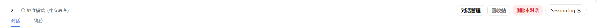

# dsh-session-manager

English | [中文](README.md)

Full **session management** inside the DeepSeek Harness web UI — reachable from both the Settings page
and the conversation header: delete (with a recoverable trash), restore archived sessions, activity
stats, continue/pause, open the log folder, unread markers, fork into a new chat, workspace grouping and
ordering, and a global context-compaction threshold. No harness changes.

This repository is a derivative of [dream12347/dsh-session-manager](https://github.com/dream12347/dsh-session-manager)
(MIT), built on its v0.2.3 artifacts, with **v0.3.0** adding: DSH-native confirmation dialogs, wider
session-ID compatibility, and **force delete**; it also fixes a startup crash caused by duplicate route
registration on plugin re-mount.

## What v0.3.0 changes

| # | Change | Detail |
|---|---|---|
| 1 | **Native dialogs** | Every `window.confirm()` / `window.alert()` is now the official `Modal` from `@deepseek-ai/dsh-client-ui-primitives`: body portal, mask blur, Escape handling, focus return, danger actions painted with `--dsw-alias-state-error-primary`, and the session id shown in a monospace block. No more OS message boxes from the desktop shell |
| 2 | **Wider session IDs** | Only `session-<hex>` used to pass validation, so ids minted by other surfaces (`od-<uuid>`) answered `invalid-session-id` and the session could not be deleted. Now any id that is safe as one path segment is accepted: `[A-Za-z0-9][A-Za-z0-9._-]{0,199}`, `..` rejected |
| 3 | **Force delete** | When a normal delete fails, the failure dialog offers Force delete: it skips the official archive step, falls back to locating the artifact at `~/.dsh/sessions/<project>/<id>`, and still moves it into the trash (restorable). `POST /dsh-session-manager/delete` accepts `{ sessionId, force: true }`; a session mid-turn is still refused |
| 4 | **Route-registration crash fix** | `webServer.register()` throws on a duplicate `(kind, path)`. A plugin re-mount (config reload, disable/enable, service replacement) re-registered the same eight routes while the previous generation was still in the table, and the exception escaped `apply()` — **failing host startup**. Routes now install through a process-wide table: a new mount takes its routes over (disposing the stale entry first), a remaining collision is logged, and a rejected `setup()` is contained so the plugin stays inactive instead of killing the host |

## Features

- A dedicated **Session Manager** section in Settings
- Lists every session (title / working directory), with a separate collapsible **archived** group and one-click restore
- **Trash**: deleted sessions go to a trash retaining the latest 10 entries; restore or purge permanently
- **Stats**: recent activity per session (turns / user messages / assistant messages / tool calls / activity window)
- **Continue** (open the session) and **Pause** (stop the running turn)
- **Unread / read**: manual unread (blue), official pending interaction (amber), official completion (green), running (spinner); click to mark read in place; the official sidebar rows mirror the blue dot
- **Fork into a new chat** through the official `sessions.fork`
- **Folder**: reveal the session log directory in the system file manager
- **Delete this conversation** from the conversation header
- **Session drawer** from the header (pinnable, closes on outside click, per-row "more" menu)
- **Workspace management**: grouping, newest/oldest ordering, drag-and-drop reordering, pin to top / rename / remove
- **Context compaction threshold** in General Settings (17%–90%), applied to every agent preset, persisted and re-applied after restart
- Bilingual UI (follows the page locale)

## Install

```sh
# Local directory (linked into the profile — keep the directory in place)
dsh plugin --profile <profile> add /absolute/path/to/dsh-session-manager

# From git
dsh plugin --profile <profile> add 'github:<owner>/dsh-session-manager#v0.3.0'

# From a tarball
pnpm pack
dsh plugin --profile <profile> add /absolute/path/to/dsh-session-manager-0.3.0.tgz
```

Restart the desktop app / `dsh web` afterwards: host plugins and client bundles load at mount time.

> If a plugin-market plugin is installed, make sure `dsh-session-manager` is not in its
> `state.json` `disabled` array, or it will be disabled again on startup.

## Screenshots





## Force delete

When a session id is not in the official catalog (for example an `od-<uuid>` minted elsewhere) or the
archive step fails, the normal delete reports an error. The failure dialog then shows the session id and
the host error code together with **Force delete**, which skips the archive step, locates the artifact by
scanning `~/.dsh/sessions/<project>/<id>`, and moves it into the trash — still restorable. A session whose
agent is mid-turn is refused even in force mode.

## How it works

| Layer | Implementation |
|---|---|
| Host | `src/index.ts` registers eight routes: `POST /delete` (archive + move a non-live artifact into the trash + record the entry; accepts `force`), `POST /restore`, `POST /purge`, `GET /trash`, `POST /open-folder`, `POST /pause`, `GET\|POST /compaction-threshold`, `GET /stats`. Uses `ctx.sessionPersistence` to locate sessions, `ctx.workspaceRegistry` to archive/unarchive, `ctx.storageDomain` for the trash and threshold, and `ctx.agents` to refuse running sessions |
| Client | `src/client/index.ts` registers a `settings.section` entry, lists sessions from `useSessions` / `useWorkspaces`, and calls the host routes. The drawer subscribes to `sessions.list`; purged ids are remembered in `localStorage` so a live session cannot come back after a refresh |

- **Dialogs** go through `useSessionDialog()`, which renders the official `Modal`
- **Routes** install through `installRoute()` into a process-wide ownership table (`Symbol.for('dsh-session-manager:routes')`): a later mount takes over, collisions are logged, disposal releases only its own generation
- **Unread** state lives in `localStorage` under `dsh.session-unread.v1`, shared with other session tools; official status dots are driven by `pendingInteraction` / `completed` / `running`
- **Compaction threshold** is persisted in the plugin's storage domain and pushed into every preset's engine on each `agent/pre-step`
- No system-prompt changes, no model tools, zero token/behaviour impact

## Limitations

- A running session cannot be deleted (the button is disabled and the host refuses)
- Subagent sessions are deletable when idle, including orphans whose parent was deleted
- A live session's in-memory state is cleaned up by DSH on restart
- Purged ids stay in `localStorage` and in the archive set (harmless residue, never shown)
- The sidebar unread dot matches by title text, so duplicate titles share one dot (the drawer uses exact ids)
- Workspace rename still uses the browser's native `prompt`

## Compatibility

Verified on **DSH 0.2.1-rc.2** (desktop). Upstream declares support for `0.1.1-rc.1` and `0.2.0-rc.2`.
Checked against 0.2.1-rc.2: `ctx.sessionPersistence.locate()` still exists; `IconTrashOutline16` is gone
(the plugin falls back to `IconTrashOutlineRegular`); `Modal` / `Button` / `StateDot` are exported by
`@deepseek-ai/dsh-client-ui-primitives@0.2.1-rc.2`.

## Development

```sh
npm install --no-save tsdown          # build-only dependency, not recorded
npx tsdown                            # emits lib/index.js and lib/client.js
node tests/route-guard.manual.mjs     # duplicate-mount / takeover regression test
```

`lib/` is a committed build artifact: rebuild and commit it after any source change. Before the edits the
toolchain reproduced both upstream bundles byte-for-byte.

## License

MIT — see [LICENSE](LICENSE). Upstream copyright belongs to dream12347; this derivative is MIT as well.
